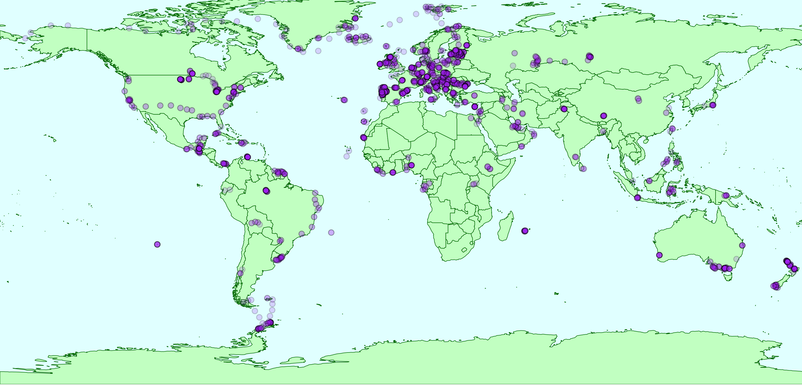

<h1 style="text-align:center;">
  FunAqua: a global dataset of fungal biodiversity in aquatic ecosystems
</h1>

## Introduction



Fungi are known to influence aquatic food webs as decomposers, regulate toxic algal blooms through parasitism, and form mutualistic associations in lichens and on the roots of hydrophytes. Despite these roles, research on aquatic fungi has historically been limited compared to studies on terrestrial fungi and other aquatic microorganisms.
Established in 2018 as a collaborative initiative between the University of Tartu and the Estonian University of Life Sciences, the FunAqua project aims to:

1. Compile a global dataset of fungal distributions in aquatic ecosystems;

2. Identify the factors shaping fungal community composition in these environments.

Currently, the FunAqua dataset includes eukaryotic long-read metabarcoding data from 1,076 sediment samples and 1,299 filtered water samples collected across 1,452 sites in 87 countries. The internal transcribed spacer (ITS) region was targeted, resulting in the identification of 50,152 fungal OTUs. Sequencing data are accompanied by comprehensive metadata, including physicochemical properties of water and sediments. The FunAqua dataset provides a valuable resource for analyzing and understanding fungal biodiversity across diverse aquatic habitats and biogeographical regions.

## The pipeline

<details>

<summary>Pipeline overview</summary>

## Pipeline overview

The pipeline deposited in this GitHub repository implements most of the steps described in the Technical Validation section of the manuscript introducing the FunAqua dataset.

The pipeline is provided in two formats: 	

* [.R script](pipeline/FunAqua_R_pipeline.R)

* [RMarkdown script](pipeline/FunAqua_markdown_pipeline.Rmd)

Both versions produce mostly the same outputs, but there are some differences:

* The RMarkdown version includes additional interactive visualizations, such as an interactive map, and several exploratory graphs that were not included in the final manuscript. These can be used for further data exploration.

* The R script contains only the data processing steps and figures that were used in the manuscript.

[The repository also includes an example HTML output generated with the markdown script ](markdown_output/FunAqua_markdown.html)

The pipeline is divided into the following sections:

<details> <summary>Pipeline sections</summary>
	
1. File preparation steps 

    1.1 Package importing

    1.2 File validation

    1.3 OTU and sequence count addition to the metadata table
   
    1.4 Phyloseq object construction
   
    1.5 Subsetting the dataset into sediment and water data

2. General data overview

    2.1 Short overview of the number of samples in the dataset

    2.2 Geographic overview
	
	* Overview of represented countries
	
	* Overview of sampled continents

   2.3 Biome overview
		
   	* Overview of sampled biomes

   	* Overview of biome sampling distribution across continents

   2.4 Sequencing data overview
		
   	* General overview of the fungal and non-fungal sequence numbers and OTUs
		
   	* Comparison of the fungal and non-fungal OTU and sequence abundance in sediment and filtered water samples
		
   	* General sequencing depth overview
		
   	* Overview of continent-specific sequencing depth
		
   	* Overview of biome-specific sequencing depth
   
   2.5 Overview of the dataset's taxonomic coverage

</details> 

The pipeline includes commented lines for saving generated plots. To save your plots, simply uncomment these lines before running the script.

The versions of the software and packages used in the pipeline is included in the file [session_info.txt](./session_info.txt)

</details>

<details> <summary>Pipeline dependencies</summary>
	
### Pipeline dependencies

The following packages are required for the .R script:

1. [tiyverse/dplyr](https://github.com/tidyverse/dplyr) (Required for basic data manipulation, included in CRAN)

2. [tidyverse/tidyverse](https://tidyverse.org/) (Required for basic data manipulation and graph generation, included in CRAN)

3. [trevorld/ggpattern](https://github.com/trevorld/ggpattern) (Required for producing side-by-side bar charts with a patterned aesthetic)

4. [rstudio/DT](https://github.com/rstudio/DT) (Required for producing interactive tables)

5. [joey711/phyloseq](https://github.com/joey711/phyloseq) (Required for easier community data manipulation)

6. [vegandevs/vegan](https://github.com/vegandevs/vegan) (Required for generating rarefaction curves)

7. [r-spatial/sf](https://github.com/r-spatial/sf) (Required for drawing the map depicting sampling plots, included in CRAN)

8. [andysouth/rworldmap](https://github.com/andysouth/rworldmap) (Required for drawing the map depicting sampling plots, included in CRAN)

9. [ropensci/rnaturalearth](https://github.com/ropensci/rnaturalearth) (Required for drawing the map depicting sampling plots)

10. [kassambara/ggpubr](https://github.com/kassambara/ggpubr) (Required for combining the heatmap plots together, included in CRAN)

11. [thomasp85/patchwork](https://github.com/thomasp85/patchwork) (Required for combining other figures together)

12. [david-barnett/microViz](https://github.com/david-barnett/microViz) (Required for easier Phyloseq object manipulation)
 
13. [EmilHvitfeldt/paletteer](https://github.com/EmilHvitfeldt/paletteer) (Required for using specific colour palettes for the heatmaps)

To run the markdown script, you additionally need:

14. [rstudio/rmarkdown](https://github.com/rstudio/rmarkdown) (Required to execute and write markdown scripts in R, included in CRAN)

15. [haozhu233/kableExtra](https://github.com/haozhu233/kableExtra) (Required for customizing interactive tables)

16. [rstudio/leaflet](https://github.com/rstudio/leaflet) (Required for generating interactive maps, included in CRAN)

To install the required packages, execute this code:
```
install.packages("tidyverse")
install.packages("ggpattern")
install.packages("DT")
install.packages("phyloseq")
install.packages("vegan")
install.packages("sf")
install.packages("rworldmap")
install.packages("rnaturalearth")
install.packages("ggpubr")
install.packages("patchwork")
install.packages("microViz")
install.packages("rmarkdown")
install.packages("kableExtra")
install.packages("leaflet")
```

</details>

<details> <summary> Hardware recommendations</summary>
	
#### Hardware recommendations

When running the pipeline on a large dataset, such as the FunAqua one, it is recommended to run the pipeline on an RStudio Server due to the high computational requirements, particularly during the sequencing depth analysis (e.g., rarefaction curve generation).

* Minimum recommended RAM: 40 GB

* RAM usage: Up to ~35-40 GB during some more intensive processes; ~18–20 GB when idle

* Disk space: The R environment with all data produced by the pipeline requires approximately 20 GB

The pipeline is designed to minimize the amount of data stored in the R environment. Wherever possible, data manipulation is performed within the calling function rather than pre-generating and saving intermediate objects. For example, contingency tables are created directly inside ggplot() calls instead of being stored beforehand.
Note: The RMarkdown document does not save any files into the R environment.

</details>


<details> <summary> Usage notes</summary>
	
#### Usage notes

Before starting the pipeline, confirm the following:

1. ✅ The required packages are installed
2. ✅ All of the files are present in your working directory

When using the example dataset or other data, additionally confirm:

4. ✅ The file names in the script are correct
5. ❗ The graphical parameters of the plotting functions are adjusted according to the used data. Currently, there are static values used for adjusting the plot visualisation (for example, axes limits in the rarefaction curve plots, hard-coded range values in  scale_fill_distiller() for heatmaps, etc), which need to be changed according to the data that is being visualised.

</details>

## Data availability

* The dataset together with sample metadata, OTU data and taxonomic classifications is available on Zenodo:
 Prins, V., FunAqua consortium, & Panksep, K. (2025). Global Fungal Biodiversity Dataset (FunAqua) [Data set]. Zenodo. https://doi.org/10.5281/zenodo.17855266

* The raw sequencing data is available on European Nucleotide Archive under bioproject PRJEB104083 (Run Accessions ERR15968726 – ERR15971436). 

## Citation
Prins, V., Tedersoo, L., Mikryukov, V. et al. The FunAqua dataset of global fungal biodiversity in aquatic ecosystems. Sci Data 13, 1346 (2026). https://doi.org/10.1038/s41597-026-07729-8
